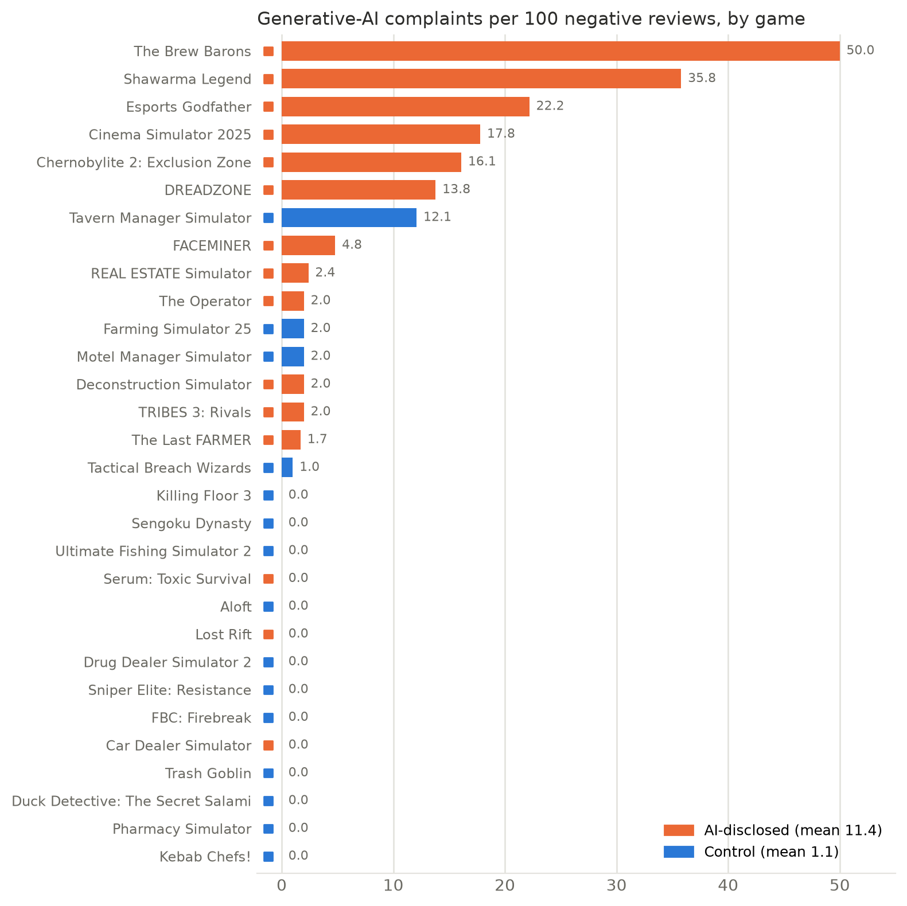

# Do Players Notice the AI, or Just the Quality?

**Authors:** Neha Kollikara and Tomas Aguilar  
**Course:** INFO 4340 – Analytics and AI, University of Denver  
**Term:** Fall 2026

## Overview

Among buyers who leave negative reviews of AI-disclosed Steam games, how often is generative AI the stated reason, compared with game quality? Criticism of a game that uses generative AI doesn't necessarily mean the AI caused the dissatisfaction. We use Claude (`claude-sonnet-4-6`) to classify negative reviews by the reason the reviewer states, validate its labels against hand labels and a keyword baseline, and compare complaint rates between AI-disclosed and control games.

## Key findings

- **Quality dominates.** In negative reviews of AI-disclosed games, an average of **88.0 per 100** mention quality problems and **11.4 per 100** mention generative AI (95% CI 4.8–19.2). A review can mention both.
- **AI complaints are concentrated in a few games.** Three games account for **83 of the 127** AI complaints in the disclosed group, and most disclosed games get almost none. Disclosed games average **10.2 more AI complaints per 100** than controls (95% CI 3.5–18.1), so AI complaints are more common on average, but the gap falls just below our pre-set minimum detectable difference (11.5), so we don't claim a firm group-wide difference.
- **Claude outperforms keywords.** On the 340-review hand-labeled test set, Claude's precision for AI complaints is **0.934**, vs. **0.593** for the keyword baseline. On a fresh 100-review holdout labeled by both authors, its precision is **0.975** (39 of 40 flags).
- **Recall is bounded, not proven.** Too few unflagged reviews were hand-checked to rule out some missed complaints, so recall lies between about 0.61 and 0.99. The workflow therefore has a person check every AI flag, plus a random audit of unflagged reviews.
- **Cost.** Labeling all **2,638 reviews** cost **$4.87** ($1.84 per 1,000). With the required human checks, the workflow costs about **$71 per 1,000**, 6x less than hand labeling.



## Data

- **Source:** Public Steam user reviews collected with `steam_reviews_scraper.py` through Steam's official review API (`IUserReviewsService/GetAppReviews`).
- **Games:** 30 paid games released 2024–2025: 15 with Steam's AI-content disclosure and 15 controls without one, each with 30+ English negative reviews in the study window.
- **Review window:** January 1, 2024 – December 31, 2025, scraped November 4, 2026. A separate set of 2026 reviews was scraped on November 15, 2026 and used only to validate the classifier.
- **Size:** 6,612 raw reviews plus 100 from two replacement games, cleaned and sampled (up to 100 per game, seed 42) to **2,638 negative English reviews**: 1,197 from disclosed games and 1,441 from controls.
- **Unit of observation:** one negative Steam review. The main analysis turns review labels into per-game rates and compares games.
- **Access:** All data used by the notebook is included in `data/`. Reviews are public; no API key is needed to rerun the analysis.

## Workflow

1. **Pilot:** Hand-check keyword matches in 312 negative reviews and define key labeling rules, such as generative AI vs. enemy/NPC "AI." These reviews became the development set and were excluded from testing.
2. **Cleaning:** Validate dates and language, remove pilot reviews and replaced games, and sample up to 100 negative reviews per game (seed 42).
3. **Keyword baseline:** Flag possible AI complaints with a fixed regex pattern.
4. **Hand labeling:** Label a 340-review test set using `LABELING_GUIDE.md`, measure agreement between the two authors, and settle disagreements together.
5. **AI classification:** Run `claude-sonnet-4-6` with a prompt built from labeling guide v4, returning a reason (`GENAI`, `QUALITY`, `BOTH`, `OTHER`, `SKIP`), a confidence, and an evidence quote as JSON. Temperature is not set; prompt caching and parallel requests are used.
6. **Evaluation:** Compare Claude with hand labels and keywords (precision, recall, F1, kappa, confusion matrix), back-test each governance threshold, rerun 100 reviews to check stability, test on a fresh 2026 holdout, and compare cost with hand labeling.
7. **Analysis:** Compare AI and quality complaint rates per 100 negative reviews between groups, with game-level bootstrap confidence intervals, rank tests, the minimum detectable difference, and sensitivity checks.
8. **Conclusion and limitations.**

## Repo Contents

```text
.
├── README.md
├── requirements.txt
├── LABELING_GUIDE.md                   # labeling rules used by both labelers and the Claude prompt
├── steam_review_ai_classifier.ipynb    # main notebook (Parts 1-8)
├── steam_review_ai_classifier.html     # rendered notebook with all outputs
├── steam_reviews_scraper.py            # Steam review collection script
├── figures/
│   └── ai_complaints_by_game.png
└── data/
    ├── games_final.csv                 # the 30 games, their group and rating tier
    ├── game_selection/                 # how the games were chosen (candidates, counts)
    ├── pilot/                          # pilot (development set) reviews and hand check
    ├── reviews/                        # raw, holdout, and cleaned reviews; keyword flags
    ├── labels/                         # hand labels, labeling keys, and settled disagreements
    ├── claude/                         # saved Claude prompt and labels (dev, main, rerun, holdout)
    └── holdout/                        # holdout sample key, group sizes, and disagreements
```

## How to Run

1. **Clone the repo and open it in VS Code**

   ```bash
   git clone https://github.com/Neha-Ko/steam-review-ai-classifier.git
   cd steam-review-ai-classifier
   code .
   ```

   (Or in VS Code: **File → Open Folder** and choose the cloned `steam-review-ai-classifier` folder.)

2. **Create a virtual environment and install the packages**

   In VS Code's terminal (**Terminal → New Terminal**):

   ```bash
   python -m venv .venv
   .venv\Scripts\activate        # Mac: source .venv/bin/activate
   pip install -r requirements.txt
   ```

3. **Add your API key** (optional, only needed to re-run Claude)

   Create a file named `.env` in the project folder containing one line:

   ```
   ANTHROPIC_API_KEY=your-key-here
   ```

   `.env` is listed in `.gitignore`, so it is never committed. Without a key, the notebook runs from Claude's saved labels in `data/claude/` and makes no API calls.

4. **Get the data**

   All data is already in the repo as dated snapshots, so nothing needs to be downloaded:
   - `data/reviews/`: Steam review scrapes (main data Nov 4, 2026; 2026 holdout Nov 15, 2026) and the cleaned sample
   - `data/labels/` and `data/holdout/`: our hand labels
   - `data/claude/`: Claude's saved labels, the frozen prompt, and raw replies for the stability rerun and holdout
   - `data/pilot/` and `data/game_selection/`: the pilot (development set) and game lists

   To re-scrape (free, no API key needed), run `steam_reviews_scraper.py` from the project folder; the exact commands are in the notebook. Steam keeps adding reviews, so a new scrape won't exactly match our snapshot.

5. **Run the notebook**

   Open `steam_review_ai_classifier.ipynb` in VS Code. Click **Select Kernel** (top right) and choose the `.venv` environment. Then click **Restart**, followed by **Run All**, in the toolbar at the top of the notebook.

   Every Claude step loads its saved labels, so the full notebook runs in a few minutes at no cost. To re-label reviews with Claude, add your key (step 3) and delete the matching CSV in `data/claude/`. This costs money (about $5 for the main run) and may give slightly different labels, so the results may not match ours exactly.

## Limitations

- **Not causal, and only reviewers are observed.** Disclosed games differ from controls in other ways (they are rated lower), disclosure is self-reported, and players who skipped a game because of AI never appear.
- **Small game sample.** With 15 games per group and a few games holding most AI complaints, the group difference is suggestive rather than firm.
- **Labeling.** The guide was refined while labeling test reviews and most test labels come from one person; a fresh holdout labeled by both authors (agreement kappa 0.83) checks precision, but recall remains bounded rather than measured.
- **Scope.** English reviews only, 30 games with relatively many reviews, and a 2024–2025 window rather than each game's launch month.
- **Model results expire.** Results reflect `claude-sonnet-4-6` as served in November 2026. Re-validate before applying the workflow to new data (see the governance memo).

## AI use

Claude (`claude-sonnet-4-6`, via the Anthropic API) is the review-classification step in this workflow, checked against hand labels at every stage. We also used AI assistants to help write code, draft documentation, and review the notebook; each author's individual AI use log describes what was used, what we changed, and how we verified it.